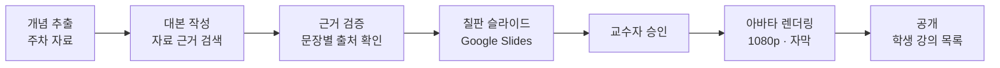
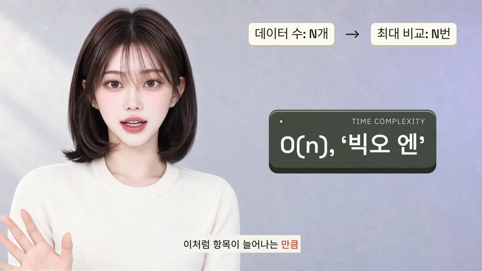
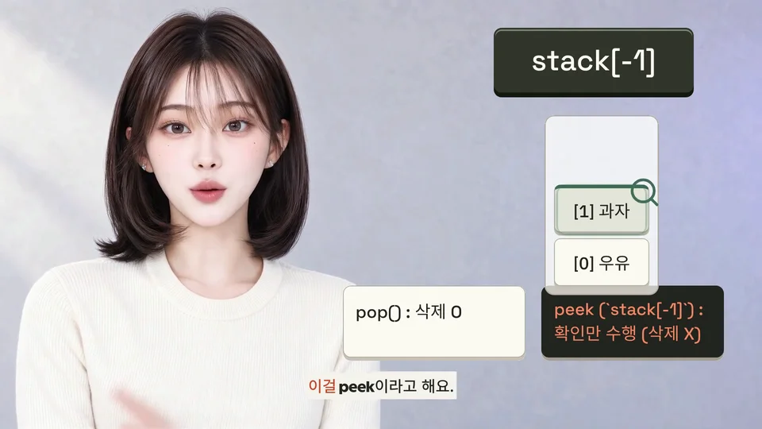
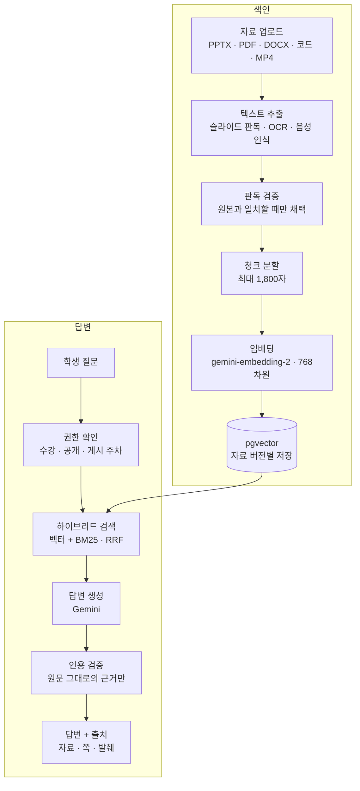
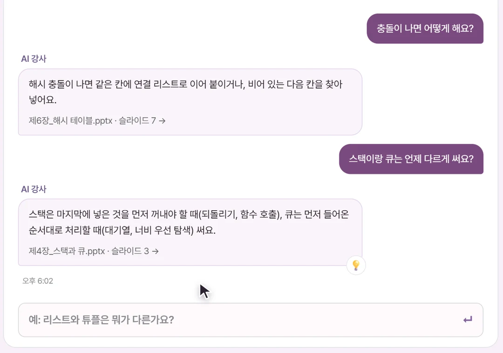
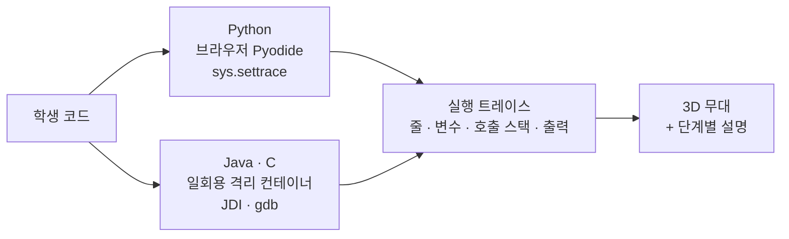
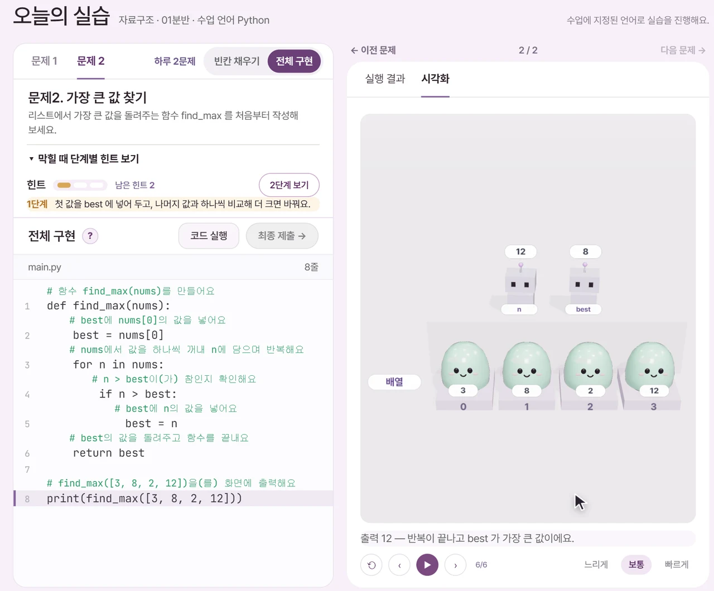
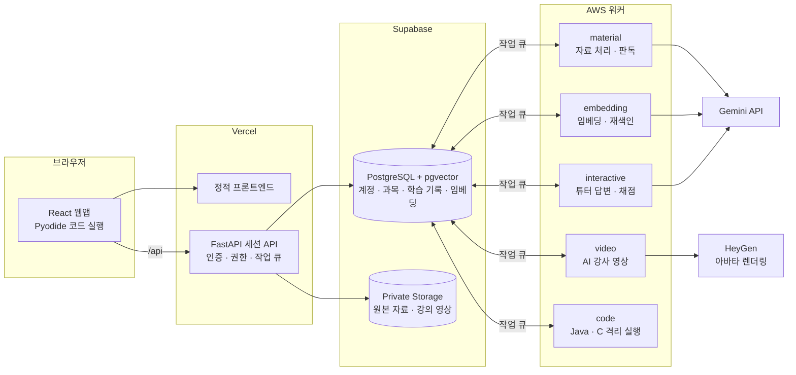

# Lerny

**강의 자료를 올리면 AI 강사의 개념 강의, 근거를 대는 AI 튜터, 코드 실행 시각화로 이어지는 알고리즘·자료구조 학습 서비스**

🔗 서비스: **https://lerny-ten.vercel.app**

<p align="center">
  
  <br>
  <sub>7주차 AI 강의 「파이썬 스택, 한 번에 이해하기」 중 append와 pop 설명</sub>
</p>

> 2026-2학기 SW캡스톤디자인 · 팀 **알고보자**
> 과제명: 알고리즘과 자료구조를 AI 코스웨어와 튜터를 결합한 교육 모델링 설계

| 🎓 AI 강사 | 🔎 RAG 파이프라인 | 🧩 코드 실행 시각화 |
| --- | --- | --- |
| 강의 자료에서 개념마다 1분 안팎의 AI 강사 영상을 만듭니다. 대본의 모든 문장은 자료에 근거합니다. | 교수자의 PPT·PDF·영상을 검증된 텍스트로 바꿔 색인하고, 학생 질문에 출처와 함께 답합니다. | 학생 코드를 한 줄씩 실행하며 변수·배열·스택을 3D 캐릭터로 보여주고, 매 단계를 문장으로 설명합니다. |

---

## 1. 🎓 AI 강사: 자료로 만드는 개념 강의

교수자가 주차 자료를 올리면 개념마다 짧은 강의 영상이 만들어집니다. 영상은 AI 강사가 칠판 슬라이드 앞에서 설명하는 형식입니다.



<p align="center">
  
  
  
  <br>
  <sub>실제 AI 강의 장면 · 6주차 「순차 탐색은 언제까지 찾아야 할까?」, 7주차 「쌓아 둔 접시는 어디서부터 꺼낼까?」, 「파이썬 스택, 한 번에 이해하기」</sub>
</p>

- **근거 있는 대본**: 해당 주차의 공개 자료에서 근거를 최대 12개까지 찾아 도입·본문·정리 구조의 50초 분량 대본을 씁니다. 모든 문장과 핵심 사실은 허용된 출처를 인용해야 합니다.
- **문장 단위 검증**: 각 주장을 원문 문장과 대조해 검토합니다. 통과하지 못하면 최대 두 번 고쳐 쓰고, 교수자 참고 자료와 다시 맞춰 봅니다. 검토를 통과한 대본만 다음 단계로 넘어갑니다.
- **칠판 슬라이드**: 대본 구간마다 슬라이드 한 장을 설계하고, 별도의 호출로 다시 검토합니다. Google Slides로 만든 슬라이드를 강의실 배경에 합성하고, 영상 포스터도 자동으로 그립니다.
- **사람의 확인**: 교수자가 슬라이드를 승인해야 렌더링하고, 공개해야 학생에게 보입니다.
- **렌더링**: 고정된 강사 아바타와 목소리로 1080p·16:9 영상과 자막을 만듭니다. 완성본이 지정한 아바타와 목소리로 만들어졌는지 확인한 뒤 private Storage에 저장하고, 짧은 시간만 유효한 서명 URL로 재생합니다.
- **학생 화면**: 주차별 개념 강의 목록에서 영상을 보고, 끝나면 다음 개념이 이어서 재생됩니다. 바로 "오늘의 문제 풀기"로 넘어갈 수 있습니다. 재생이 끊기면 새 주소로 자동 재시도하고 보던 위치로 돌아갑니다.
- **비용 안전장치**: 아바타 렌더링(HeyGen)은 유료라서 호출과 렌더링이 기본으로 꺼져 있고, 운영자가 명시적으로 켜야 동작합니다.

## 2. 🔎 RAG 파이프라인: 검증된 자료만 근거로

학생이 받는 답변, 퀴즈, AI 강사 대본은 모두 같은 색인에서 근거를 찾습니다. 그래서 색인에 들어가는 텍스트부터 검증합니다.



<p align="center">
  
  <br>
  <sub>답변마다 근거가 된 강의 자료와 슬라이드가 붙습니다 (서비스 소개 페이지의 체험 화면, 예시 데이터)</sub>
</p>

**색인**

- **슬라이드 판독**: PPT의 도형을 하나씩 잘라 Gemini로 읽고, PPT 원본 텍스트와 일치할 때만 채택합니다. 그림 속 글자는 독립된 두 번의 판독이 서로 일치해야 채택합니다. 확인하지 못한 슬라이드는 보류되어 교수자 검토로 넘어갑니다.
- **다양한 자료**: 그림 글자는 Tesseract(한·영) OCR로, 강의 영상은 faster-whisper 음성 인식으로 텍스트를 얻습니다. DOCX와 코드 파일은 원문을 그대로 추출합니다.
- **자료 버전**: 청크는 자료 버전에 속합니다. 새 버전을 활성화하면 이전 색인이 교체되고 과목의 접근 기준도 갱신됩니다.

**답변**

- **검색 전 권한 확인**: 수강 중인 학생인지 검색 전과 모델 호출 전후에 다시 확인합니다. 비공개 자료와 정답 자료는 학생용 검색에서 제외합니다.
- **하이브리드 검색**: 벡터 검색과 BM25 키워드 검색 결과를 RRF(Reciprocal Rank Fusion)로 합칩니다.
- **인용 검증**: 답변의 모든 주장은 원문을 그대로 인용한 근거가 있어야 하고, 비공개 정답 기준으로 한 번 더 검토합니다. 답변에는 자료·쪽·발췌가 출처로 붙습니다.
- **근거가 없을 때**: 지어내지 않고 "강의 자료에 없는 내용"이라고 답합니다. 검증에 실패한 답변은 보류합니다.
- **이어지는 질문**: 앞선 대화를 반영해 질문을 독립된 문장으로 다시 쓴 뒤 검색하고, 이전 출처를 유지합니다.

**비용 관리**: Gemini 호출은 기본으로 꺼져 있고 전용 AWS 워커에서만 실행합니다. 자료 버전마다 유료 호출 예산(기본 1,500회)을 두고, 분당 요청·토큰 수와 동시 실행을 공유 DB에서 제한합니다 ([gemini_quota.py](apps/api/lerny/gemini_quota.py)).

## 3. 🧩 코드 실행 시각화: 코드가 도는 모습을 눈으로

실습 문제를 풀면서 내 코드가 한 줄씩 실행되는 과정을 3D 무대에서 볼 수 있습니다.



<p align="center">
  
  <br>
  <sub>배열은 젤리, 변수는 로봇으로 나타나는 3D 무대와 재생 조작 (서비스 소개 페이지의 체험 화면, 예시 데이터)</sub>
</p>

- **3D 무대**: 변수는 로봇, 배열 원소는 젤리, 스택은 펭귄, 연결 리스트는 기차로 나타납니다. 큐와 덱도 줄로 보여주고, 변수가 가리키는 배열은 관으로 이어집니다. 교환·대입·삽입·삭제가 일어나면 그 변화를 보여줍니다.
- **재생 조작**: 처음·이전·재생·다음 버튼, 탐색 슬라이더, 3단계 속도, 단축키, 오류 위치로 바로 가기를 제공합니다. 코드 창에는 방금 실행한 줄, 다음 줄, 오류 난 줄이 표시되고, 호출 스택·프레임별 변수표·출력이 함께 나옵니다.
- **단계별 설명**: 매 단계를 한 문장으로 풀어 줍니다. 어떤 줄이 실행됐는지, 조건이 참인지 거짓인지, 무엇이 바뀌었는지를 규칙으로 만들기 때문에 AI 호출 없이 즉시 나옵니다. 오류가 나면 원인과 힌트를 보여줍니다.
- **빈칸 실습과 연결**: Python 빈칸 문제는 아직 채우지 않은 첫 빈칸 바로 앞에서 실행을 멈춰 보여줍니다. 예시 출력과 비교해 문법 오류·실행 오류·무한 반복·오답을 구분하고 문제가 된 줄의 빈칸을 짚어 줍니다. 최종 채점은 제출 후 서버에서 따로 합니다.
- **AI 튜터와 연결**: 실습 중 질문하면 지금 보고 있는 단계와 줄이 함께 전달됩니다.

**학생 코드는 서버에서 실행하지 않습니다.**

| 언어 | 실행 위치 | 제한 |
| --- | --- | --- |
| Python | 학생 브라우저의 Pyodide (Web Worker) | 이벤트 20,000개, 10초. 입력·파일·네트워크 사용 코드는 실행 전에 차단 |
| Java · C | AWS의 일회용 Docker 컨테이너 ([deploy/trace-sandbox](deploy/trace-sandbox)) | 네트워크 없음, 읽기 전용 루트, 모든 권한 제거, CPU 1개, 메모리 768MiB, 프로세스 128개, 35초 |

---

## 그 밖의 기능

| 학생 | 교수자 |
| --- | --- |
| **오늘의 이론**: 배운 주차까지의 개념으로 만든 퀴즈, 단계별 힌트와 해설 | **자료 업로드**: 주차와 공개 여부를 지정하고 자료 버전을 관리 |
| **AI 튜터**: 퀴즈 결과나 강의를 보다 생긴 질문에 출처와 함께 답변 | **자동 콘텐츠 준비**: 개념·문항·실습 생성과 검증, 실패하면 보류 후 재시도 |
| **학습 기록**: 개념별·날짜별 이해도, 다시 볼 개념, 연속 학습과 XP | **진도 관리**: 16주 일정에 따라 자동 진행하고 실제 수업에 맞춰 조정 |
| **시험 대비**: 공개된 시험 범위의 기출·연습 문제와 서술형 | **학습 분석**: 참여 현황, 주차별 이해도, 학생들이 어려워하는 개념 |

퀴즈와 실습 결과는 학교의 공식 성적이나 출결에 반영하지 않습니다.

## 시스템 구조



웹과 API는 Vercel 한 프로젝트에서 서비스합니다 ([vercel.json](vercel.json)). 오래 걸리는 작업(자료 처리, 임베딩, 영상, 채점)은 DB 작업 큐에 넣고 역할별 AWS 워커가 처리합니다.

## 기술 스택

| 영역 | 사용 기술 |
| --- | --- |
| 프론트엔드 | React 19, TypeScript, Vite 7, React Router, Three.js, Motion, Pyodide |
| 백엔드 | Python 3.12, FastAPI, SQLAlchemy 2, Alembic, psycopg 3 |
| AI·검색 | Gemini (생성·검증·임베딩), pgvector, BM25 + RRF 하이브리드 검색 |
| 자료 처리 | python-pptx, pypdf, python-docx, Tesseract OCR, faster-whisper, tree-sitter |
| AI 강사 | Google Slides API, HeyGen, Pillow |
| 코드 실행 | Pyodide, JDI(Java), gdb(C), Docker |
| 인프라 | Vercel, Supabase (PostgreSQL·Storage), AWS EC2·SSM, systemd |

## 저장소 구조

```text
apps/
  web/                  React 웹앱
    src/visualization/  3D 실행 시각화 화면
    src/visualizer/     Python 트레이서(Pyodide)와 빈칸 검사
  api/
    lerny/              FastAPI 서비스
      rag_*.py, retrieval.py         RAG 검색과 답변
      ppt_*.py, document_*.py        자료 판독과 검증
      narration_*.py, lecture_*.py   AI 강사 대본·슬라이드
      video_worker.py                AI 강사 영상 렌더링
      tracing/                       Java·C 트레이서
    rag_mvp/ quiz_mvp/ video_extraction/   팀 엔진
    tests/              API 테스트
deploy/
  aws/                  워커 설치·실행 (systemd 서비스)
  trace-sandbox/        Java·C 격리 실행 환경
migrations/             DB 마이그레이션
scripts/                로컬 실행·점검·운영 스크립트
docs/                   기획·설계·운영 문서
```

## 로컬에서 실행하기

Python 3.12, [uv](https://docs.astral.sh/uv/), Node.js가 필요합니다. 모델·캐시·가상환경 같은 런타임 데이터는 저장소 밖 `LERNY_RUNTIME_ROOT`(기본값 `%USERPROFILE%\LernyData`)에 둡니다.

1. [`scripts/team.env.example`](scripts/team.env.example)을 저장소 밖으로 복사해 값을 채웁니다. 기본 위치는 `%USERPROFILE%\LernyPrivateData\secrets\team.env`이고, 다른 경로를 쓰려면 `LERNY_ENV_FILE`을 지정합니다. 자세한 항목은 [통합 환경 설정](docs/21_통합_환경설정.md)을 참고하세요.

2. 설정을 점검하고 서비스를 각각 다른 터미널에서 실행합니다.

   ```powershell
   .\scripts\Start-Team.ps1 -Component check
   .\scripts\Start-Team.ps1 -Component api      # http://127.0.0.1:8000
   .\scripts\Start-Team.ps1 -Component worker
   .\scripts\Start-Team.ps1 -Component web      # http://127.0.0.1:5173
   ```

기본 실행에서는 유료 API 호출이 꺼져 있습니다. DB 연결과 마이그레이션은 별도로 준비해야 하며, 실행 스크립트는 기존 DB를 변경하지 않습니다.

## 테스트

테스트는 공유 DB가 아닌 격리된 로컬 DB와 가짜 제공자로 실행합니다. 런타임 폴더의 설정 파일이 공유 DB를 가리킬 수 있으므로, **먼저 `LERNY_RUNTIME_ROOT`를 빈 폴더로 지정**하세요.

```powershell
$env:LERNY_RUNTIME_ROOT = "$env:TEMP\lerny-test"
uv run pytest
```

```powershell
cd apps\web
npm ci
npm run test:student
npm run build
```

## 문서

| 문서 | 내용 |
| --- | --- |
| [기능 명세 초안](<Lerny 기능 명세 초안.md>) | 최초 기능 명세 |
| [확정 기획](docs/11_확정_기획_2026-10-12.md) | 기능 정책의 기준 |
| [시스템 구조와 개발환경](docs/02_시스템_구조와_개발환경.md) | 권한·신뢰 경계, 작업 처리 구조 |
| [데이터와 상태](docs/03_데이터와_상태_명세.md) | DB 모델과 상태 전이 |
| [API 계약](docs/04_API_계약.md) | API 목록 |
| [AI와 자료 처리](docs/05_AI와_자료처리_명세.md) | 자료 처리·생성 파이프라인 |
| [실행과 시각화](docs/06_실행과_시각화_명세.md) | 코드 실행·트레이스 |
| [Vercel·Supabase 이전](docs/16_Vercel_Supabase_이전.md) | 배포 구조 |
| [팀원 최신본 통합](docs/20_팀원_최신본_통합.md) | 팀 엔진 통합 기록 |
| [워커 배포 절차](docs/ppt-review-worker-rollout.md) | AWS 워커 배포 |

날짜가 붙은 문서는 작성 당시의 상태를 기록한 이력입니다.

## 팀

| 이름 | 소속 |
| --- | --- |
| 오준혁 (팀장) | 콘텐츠IT |
| 오민채 | 콘텐츠IT |
| 신정윤 | 빅데이터 |
