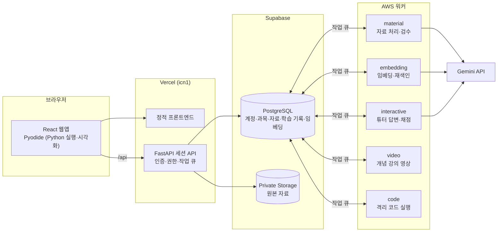

# Lerny

**교수님이 올린 강의 자료가 AI 강의, 오늘의 퀴즈, 코드 실습, 근거 있는 AI 튜터로 이어지는 알고리즘·자료구조 학습 서비스**

🔗 서비스: **https://lerny-ten.vercel.app**

> 2026-2학기 SW캡스톤디자인(산학협력형) · 팀 **알고보자**
> 과제명: 알고리즘과 자료구조를 AI 코스웨어와 튜터를 결합한 교육 모델링 설계

---

## 왜 만들었나

강의 자료는 PPT, PDF, 영상으로 흩어져 있고, 학생은 수업이 끝나면 무엇을 복습해야 할지 모릅니다. 교수자는 학생이 어디서 막히는지 시험을 보기 전까지 알기 어렵습니다.

Lerny는 교수자가 **자료를 올리기만 하면** 개념 추출, 문제 생성, 검증까지 자동으로 처리합니다. 학생은 매일 짧은 학습을 이어가고, 교수자는 그 기록에서 학생들이 어려워하는 개념을 확인합니다.

## 핵심 기능

### 학생

| 기능 | 내용 |
| --- | --- |
| **AI 개념 강의** | AI 강사가 개념마다 칠판의 도표와 예시로 짧게 설명하는 강의 영상 |
| **오늘의 이론** | 배운 주차까지의 개념으로 만든 퀴즈. 단계별 힌트, 강의 자료 근거, 해설 제공 |
| **오늘의 실습** | 배정된 코드 문제를 풀고, 실행 흐름을 단계별 시각화로 확인 (Python·Java·C) |
| **AI 튜터 질문** | 퀴즈 결과나 강의를 보다 생긴 질문에 강의 자료의 근거와 함께 답변 |
| **학습 기록** | 개념별·날짜별 이해도, 다시 살펴볼 개념, 연속 학습과 XP |
| **시험 대비** | 공개된 시험 범위의 기출·연습 문제와 서술형 문항 |

### 교수자

| 기능 | 내용 |
| --- | --- |
| **자료 업로드** | 주차와 공개 여부를 지정해 PPT·PDF·문서·영상 업로드. 자료 버전 관리 |
| **자동 콘텐츠 준비** | 공개 자료에서 개념, 이론 문항, 실습 문제를 생성하고 검증. 실패한 콘텐츠는 보류 후 재시도 |
| **진도 관리** | 16주 학기 일정에 따라 자동 진행. 실제 수업 진도에 맞춘 수동 조정 |
| **생성 문항 관리** | 만들어진 문항과 해설을 확인하고 수정, 서술형 검토 |
| **학습 분석** | 참여 현황, 주차별 이해도, 학생들이 어려워하는 개념 |

퀴즈와 실습 결과는 학교의 공식 성적이나 출결에 반영하지 않습니다. 학생의 이해를 돕고 교수자가 수업을 조정하는 참고 자료로 씁니다.

## 시스템 구조



- 웹과 API는 Vercel 한 프로젝트에서 서비스합니다. `/api/*`는 FastAPI로, 나머지는 프론트엔드로 연결됩니다 ([vercel.json](vercel.json)).
- 시간이 오래 걸리는 작업(자료 처리, 임베딩, 영상, 채점)은 DB 작업 큐에 넣고 AWS 워커가 처리합니다.
- 학생 코드는 서버에서 실행하지 않습니다. Python은 브라우저의 Pyodide에서, Java·C는 네트워크가 차단되고 CPU·메모리·프로세스·시간이 제한된 일회용 AWS 샌드박스에서 실행합니다 ([deploy/trace-sandbox](deploy/trace-sandbox)).

## 기술 스택

| 영역 | 사용 기술 |
| --- | --- |
| 프론트엔드 | React 19, TypeScript, Vite 7, React Router, Motion, Three.js, Pyodide |
| 백엔드 | Python 3.12, FastAPI, SQLAlchemy 2, Alembic, psycopg 3, Argon2, TOTP |
| 자료 처리 | python-pptx, pypdf, python-docx, tree-sitter, LlamaIndex, faster-whisper, OpenCV |
| AI | Google Gemini (자료 검수, 문항 생성, 임베딩, 튜터 답변) |
| 인프라 | Vercel, Supabase (PostgreSQL·Storage), AWS EC2·SSM, systemd |
| 도구 | uv, npm, pytest, Ruff, Prettier |

## 저장소 구조

```text
apps/
  web/                  React 웹앱 (학생·교수자·관리자 화면, 코드 시각화)
  api/
    lerny/              FastAPI 서비스: 인증·권한, 과목·자료, 작업 큐, 퀴즈·실습·채점, RAG
    rag_mvp/            검색 증강 답변 엔진
    quiz_mvp/           문항 생성 엔진
    video_extraction/   영상 자료 추출 엔진
    tests/              API 테스트
deploy/
  aws/                  워커 설치·실행 (systemd 서비스, 설치기)
  trace-sandbox/        Java·C 격리 실행 환경
migrations/             Alembic DB 마이그레이션
scripts/                로컬 실행·점검·운영 스크립트 (PowerShell, Python)
docs/                   기획, 설계, 운영 문서
main.py                 Vercel FastAPI 진입점
```

## 로컬에서 실행하기

Python 3.12, [uv](https://docs.astral.sh/uv/), Node.js가 필요합니다. 모델·캐시·가상환경 같은 런타임 데이터는 저장소 밖 `LERNY_RUNTIME_ROOT`(기본값 `%USERPROFILE%\LernyData`)에 둡니다.

1. [`scripts/team.env.example`](scripts/team.env.example)을 저장소 밖으로 복사해 값을 채웁니다. 기본 위치는 `%USERPROFILE%\LernyPrivateData\secrets\team.env`이고, 다른 경로를 쓰려면 `LERNY_ENV_FILE`을 지정합니다. 자세한 항목은 [통합 환경 설정](docs/21_통합_환경설정.md)을 참고하세요.

2. 설정을 점검하고 서비스를 각각 다른 터미널에서 실행합니다.

   ```powershell
   .\scripts\Start-Team.ps1 -Component check
   .\scripts\Start-Team.ps1 -Component api      # http://127.0.0.1:8000
   .\scripts\Start-Team.ps1 -Component worker
   .\scripts\Start-Team.ps1 -Component web      # http://127.0.0.1:5173
   ```

기본 실행에서는 유료 API 호출이 꺼져 있습니다. DB 연결과 마이그레이션은 별도로 준비해야 하며, 실행 스크립트는 기존 DB를 변경하지 않습니다.

## 테스트

테스트는 공유 DB가 아닌 격리된 로컬 DB와 가짜 제공자로 실행합니다. 런타임 폴더의 설정 파일이 공유 DB를 가리킬 수 있으므로, **먼저 `LERNY_RUNTIME_ROOT`를 빈 폴더로 지정**하세요.

```powershell
$env:LERNY_RUNTIME_ROOT = "$env:TEMP\lerny-test"
uv run pytest
```

```powershell
cd apps\web
npm ci
npm run test:student
npm run build
```

## 운영 원칙

- **권한 확인 후 검색**: 공유 임베딩을 검색하기 전에 요청자가 과목과 자료에 접근할 수 있는지 확인합니다. 비공개 자료는 학생용 답변·문제·영상의 근거에서 제외합니다.
- **원본 비공개**: 원본 자료는 private Storage 버킷에 저장합니다.
- **유료 호출 한도**: Gemini 호출은 자료 버전별 예산과 분·일 단위 요청 한도로 제한합니다 ([gemini_quota.py](apps/api/lerny/gemini_quota.py)).
- **시크릿 분리**: 키와 학생·교수자 데이터는 저장소에 커밋하지 않습니다. 운영 설정은 AWS SSM으로 관리합니다.
- **워커 배포**: [워커 배포 절차](docs/ppt-review-worker-rollout.md)를 따릅니다.

## 문서

| 문서 | 내용 |
| --- | --- |
| [기능 명세 초안](<Lerny 기능 명세 초안.md>) | 최초 기능 명세 |
| [확정 기획](docs/11_확정_기획_2026-10-12.md) | 기능 정책의 기준 |
| [시스템 구조와 개발환경](docs/02_시스템_구조와_개발환경.md) | 권한·신뢰 경계, 작업 처리 구조 |
| [데이터와 상태](docs/03_데이터와_상태_명세.md) | DB 모델과 상태 전이 |
| [API 계약](docs/04_API_계약.md) | API 목록 |
| [AI와 자료 처리](docs/05_AI와_자료처리_명세.md) | 자료 처리·생성 파이프라인 |
| [실행과 시각화](docs/06_실행과_시각화_명세.md) | 코드 실행·트레이스 |
| [Vercel·Supabase 이전](docs/16_Vercel_Supabase_이전.md) | 배포 구조 |
| [팀원 최신본 통합](docs/20_팀원_최신본_통합.md) | 팀 엔진 통합 기록 |
| [저장소 이전과 인수인계](docs/15_저장소_이전과_개발_인수인계.md) | 저장소 이전 이력 |

날짜가 붙은 문서는 작성 당시의 상태를 기록한 이력입니다.

## 팀

| 이름 | 소속 |
| --- | --- |
| 오준혁 (팀장) | 콘텐츠IT |
| 오민채 | 콘텐츠IT |
| 신정윤 | 빅데이터 |
