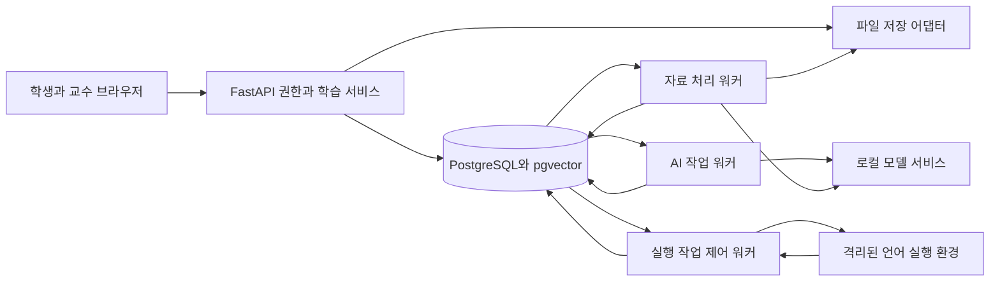

> **2026-10-12 정책 갱신:** [확정 기획 v0.4](11_확정_기획_2026-10-12.md)를 최신 기준으로 적용한다. 이 문서의 충돌하는 이전 정책·설계는 [변경 대조표](12_기획_변경_대조표.md)를 따르며, 세부 계약 갱신과 미완료 구현은 [남은 개발 작업](13_남은_개발_작업.md)에 정리했다. 이 안내는 구현 완료를 의미하지 않는다.

# Lerny 시스템 구조와 개발환경

버전 0.1 · 2026-10-09 · 기술 선택은 구현 기준, 성능은 측정 대기

초기 시스템은 개발 PC 한 대에서 무료 도구와 직접 실행 모델로 구성한다. 프론트, API, 데이터 저장, AI 처리, 학생 코드 실행을 프로세스 경계로 나누어 추후 일반 서버와 GPU 서버로 옮길 수 있게 한다. 외부 LLM API는 사용하지 않는다.

## 초기 기술 선택

| 영역 | 구현 기준 | 선택 이유와 경계 |
| --- | --- | --- |
| 프론트 | React·TypeScript·Vite, 새 화면 구조 | 학생/교수/운영 공통 컴포넌트, API에서 생성한 타입. 기존 디자인을 가져오지 않음 |
| API | Python·FastAPI·Pydantic, SQLAlchemy·Alembic | AI 작업과 데이터 모델 언어 통일. 요청 안에서 무거운 모델·코드를 실행하지 않음 |
| 데이터 | PostgreSQL와 pgvector | 관계·권한·작업 큐·벡터를 한 DB에 저장. 초기 별도 Redis 불필요 |
| 작업 큐 | PostgreSQL 작업 테이블, lease·heartbeat·재시도 | API 저장과 작업 등록을 하나의 트랜잭션으로 처리 |
| 모델 | 로컬 Ollama 어댑터, 임베딩·전사 별도 로컬 작업 | 공급자에 종속되지 않은 내부 요청 계약. 클라우드 모델 자동 대체 금지 |
| 파일 | LocalObjectStore, 비공개 디렉터리 | 상대 object key만 DB에 저장. 향후 S3 호환 어댑터로 교체 |
| 코드 실행 | WSL2 Linux 환경의 격리된 실행 워커 | 웹 API와 분리. C/Java/Python 도구를 고정한 언어별 이미지 |
| 배포 설정 | 환경변수·잠금 파일·이미지 digest | 개발용과 향후 서버용 설정 분리, 비밀은 저장소 밖 |

정확한 라이브러리 버전은 환경 구성 시 호환성 검증 후 잠금 파일에 고정한다. 기존 저장소의 버전을 새 프로젝트의 최신·권장 버전으로 간주하지 않는다. 모델은 한국어 근거 답변·서술형·구조화 응답 비교 실험 후 ID·리비전·양자화·라이선스를 고정한다.

## 권한과 신뢰 경계

브라우저는 DB·모델·실행 데몬·파일 디렉터리에 직접 접근하지 않는다. API는 로그인 세션과 과목/분반 권한을 검사하고 학생·교수·운영용 응답 모델을 분리한다. 세션 쿠키는 HttpOnly, 배포 HTTPS에서는 Secure, SameSite=Lax로 설정한다. 상태 변경에는 CSRF 방어를 적용하고 비밀번호는 Argon2id로 해시한다. 초기 로컬 개발도 계정 권한을 생략하지 않는다.

자료 텍스트와 학생 코드는 신뢰하지 않는 입력이다. 자료 속 지시문은 모델 도구 실행이나 권한 변경을 유발할 수 없다. 코드 실행 프로세스에는 DB 암호·원본 자료·모델 토큰·호스트 디렉터리·컨테이너 소켓을 전달하지 않는다. DB 접속 권한은 API, AI 워커, 실행 제어 워커, 유지관리 계정에 필요한 범위로 나눈다.

## 작업과 중복 방지

작업 상태는 `queued → running → succeeded | failed | cancelled`이며 재시도 대기는 `retry_wait`다. 상태 전이에 attempt 번호와 실행 토큰을 사용한다. lease가 만료된 이전 워커의 결과는 저장을 거부한다. 작업 실행은 중복될 수 있지만 학습 기록·채점 확정·알림 같은 부수 효과는 고유 키와 트랜잭션으로 한 번만 반영한다.

초기 lease 60초, heartbeat 15초, 일시 장애 자동 재시도 최대 2회와 5초·20초 지연을 사용한다. 입력 오류·권한 오류·문항 검증 실패·학생 실행 시간 초과는 자동 반복하지 않는다. API는 작업 ID를 즉시 반환하고 작업 진행은 2초 폴링에서 최대 10초까지 늘린다. 탭 비활성 시 폴링을 줄인다. 결과는 소유자 또는 명시적 담당 권한으로 조회한다.

GPU 작업은 처음에는 동시 추론 1개로 제한한다. 공개 챗봇/서술형과 내부 비공개 검증 컨텍스트는 요청별로 완전히 분리한다. 대화 3개를 처리한 뒤 오래 기다린 채점 작업 1개를 우선 배정하는 가중 스케줄링을 사용하고, 2분 이상 대기 작업은 우선도를 높인다. 임베딩·전사·대량 생성은 수업 질문보다 낮은 우선순위다. 모든 GPU 소비 작업은 같은 자원 예약기를 거친다.

초기 AI 대기 상한 50개, 사용자별 미완료 대화 1개·채점 3개를 둔다. 대화는 대기 120초·실행 90초, 채점은 대기 10분·실행 120초를 초기 제한값으로 둔다. 만료는 오답이 아니라 재시도 가능한 실패/채점 보류다. 상한 초과는 429와 Retry-After로 응답한다. 이 수치는 운영 성능 약속이 아니라 과부하 방어 초기값이다.

## 데이터 공개 변경

과목 `access_epoch`를 공개·권한·활성 자료 변경 때 증가시킨다. 검색 시작과 응답 직전에 현재 권한·epoch를 검사한다. 캐시 키는 사용자 범위·과목·epoch·자료 리비전·모델/프롬프트 버전을 포함한다. epoch가 다르면 캐시를 읽지 않는다. 과거 출처 링크도 매 요청 권한을 검사한다. 비공개 전환 전에 이미 다운로드하거나 본 내용까지 회수할 수 있다는 보장은 하지 않는다.

서버는 공개 변경 시 종속 콘텐츠를 즉시 차단하고, 파일·벡터·생성 결과 정리는 비동기로 수행한다. 새 응답이 나가기 전 검사에 실패하면 생성 결과를 폐기하거나 재검색한다. 학생용 답변은 검증 후 한 번에 공개하며, 검증 전 토큰을 스트리밍하지 않는다.

## 개발 PC 확인과 설치 관문

2026-10-09 현재 확인된 장비는 RTX 3070 8GB, RAM 약 32GB다. 최종 운영 장비로 확정한 것은 아니다. Docker 실행 파일은 현재 검색되지 않았고 WSL의 사용 가능한 Linux 실행 환경도 검증되지 않았다. 환경 구성 전에 Windows·WSL2 버전, CPU, 남은 디스크, 가상화 지원, 드라이버와 GPU 인식을 기록한다.

WSL2 Linux + 무료 Docker Engine을 기본 경로로 삼고 모델 서비스는 Windows 로컬 또는 WSL GPU 실행 중 검증된 한 경로를 고른다. 설치·재부팅·대규모 모델 다운로드는 실제 환경 구성 단계에서 수행한다. Docker Desktop 유료 플랜·클라우드 계정은 전제로 두지 않는다. 문서 작성 단계에서는 설치나 네트워크 공개를 수행하지 않는다.

프로젝트 코드는 사용자가 지정한 `D:\캡스톤디자인_Lerny`에서 관리한다. 2026-10-09 C 드라이브 공간 부족으로 D 드라이브를 활성 작업 위치로 변경했다. 실행 데이터·모델·가상환경·패키지 캐시는 코드 폴더 밖 `D:\LernyData` 아래에 분리한다. WSL의 Linux 볼륨도 설치 시 D 드라이브 배치를 검증한다. 경로는 설정으로 바꾸며 소스 디렉터리 상대경로에 민감 자료를 자동 저장하지 않는다. 이전 C 드라이브 문서는 보존본이며 이후 수정은 D 드라이브에 적용한다.

## 향후 서버 이전

프론트/API/DB/파일과 GPU 모델 서비스를 별도 호스트로 옮겨도 도메인 계약은 유지한다. 바뀌는 것은 DB URL, 모델 base URL, 파일 어댑터, 실행 워커 주소·인증이다. 일반 서버에서 GPU 서비스로 가는 연결은 인증·암호화하고 공개 모델 포트를 직접 노출하지 않는다. 이전 전 DB·파일 체크섬 백업, 작업 중지·drain, 복원, smoke test, 되돌리기 순서를 검증한다. 새 장비에서 부하 테스트를 다시 통과해야 한다.

## 기술 근거

- 관계 데이터와 벡터 저장을 함께 쓰는 선택의 근거: [pgvector](https://github.com/pgvector/pgvector).
- Ollama 로컬 모드는 클라우드 기능을 끌 수 있다. `OLLAMA_NO_CLOUD=1`과 외부 목적지 차단을 함께 적용한다. 동시성·컨텍스트 크기는 메모리 사용에 영향을 주므로 실측한다. [Ollama FAQ](https://docs.ollama.com/faq).
- 컨테이너만 만들고 제한을 생략하면 충분한 실행 경계가 되지 않는다. 자원·권한·호스트 접근 설정을 함께 검증한다. [Docker 보안](https://docs.docker.com/engine/security/), [자원 제한](https://docs.docker.com/engine/containers/resource_constraints/).
