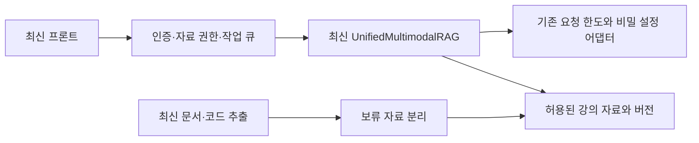

# 2026-11-10 팀원 최신본 통합

후속 변경: 환경 파일과 용도별 키 설정은 [통합 환경 설정](21_통합_환경설정.md)을 우선한다. 아래 환경 파일 설명은 최초 통합 당시 기록이다.

사용자가 팀원 작업물이 기존 개인 작업보다 최신이라고 지정했다. 최신 프론트·엔진을 기준으로 합치고, 기존 작업은 백업 후 필요한 서비스 연결부만 반영했다. Git 커밋·푸시·배포·실제 모델 호출·기존 운영 DB 변경은 수행하지 않았다.

## 기준과 백업

| 구분 | 원본 / 적용 |
| --- | --- |
| 최신 프론트 | `C:\Users\USER\Downloads\Lerny-20261110T050610Z-1-001.zip` → `apps/web`, 최신 tracing 프로토콜 |
| 최신 엔진 | `C:\Users\USER\OneDrive - 한림대학교\문서\카카오톡 받은 파일\Lerny_소스코드_및_문서_전체.zip` → `apps/api/rag_mvp`, `quiz_mvp`, `video_extraction` |
| 기존 서비스에서 유지 | 실제 로그인·CSRF·분반/자료 권한, SQLAlchemy/Alembic, 작업 큐·재시도, 파일 저장, 모델 요청 한도·중복 방지, 근거 검증, 기존 HeyGen 영상 연결 |
| 최신 구현으로 교체 | 프론트 화면·실습 UI·Python 브라우저 실행·Java/C trace 경로. 이전 자체 trace 구현과 해당 테스트는 백업에 보존 |
| 제외 | ZIP의 node_modules, 캐시, 실험 work 폴더, 쓰이지 않는 기존 화면 컴포넌트. 엔진 실험 서버는 서비스 로그인으로 연결하지 않음 |

작업 체크아웃은 `C:\Users\USER\dev\Lerny`이고, 시작 시 `master`, HEAD `a598b6d`였다. 원격은 `jun030426/TraceLens__jmj`이다. 변경 전 파일 579개는 `.git`과 미커밋 작업을 포함해 아래 ZIP에 저장하고 각 파일 SHA-256을 대조했다. node_modules 연결은 대상 경로만 기록하고 따라가지 않았다. 원래 런타임·DB·키·모델·기존 가상환경은 변경하지 않았다.

```text
C:\Users\USER\LernyData\integration\20261110-team-latest\
  backup/Lerny-before-integration.zip
  backup/manifest.json
  backup/status.txt, staged.patch, unstaged.patch, head.txt
  incoming-manifest.json
  assembly-decisions.json
  applied-manifest.json
  workspace/                  # 검사에 사용한 통합본
  preview-runtime/teacher-materials.png
```

`assembly-decisions.json`은 조립 시 기존 서비스에서 가져온 파일과 이유를 기록한다. 최종 파일은 `applied-manifest.json`에 기록한다. 네 개의 미사용 자료 UI 파일과 이전 trace 구현은 조립 이후 제외했다. 백업은 복구용이며 원격 업로드 대상이 아니다.

## 실제 연결



- `team_engine.py`: 권한 검사로 한정한 DB 청크를 최신 엔진에 전달한다. 엔진의 키워드 검색·벡터 결합·질문 프롬프트·객관식 생성·숏츠 대본을 사용한다. 빈 강의/개념 필터가 전체 데이터로 확장되는 동작을 차단했다. 서비스의 독립적인 답변 근거 검증과 자료 버전 검사도 유지한다.
- 임베딩은 최신 `Google.embed`를 기존 요청 한도·중복 방지 어댑터로 호출한다. 인덱스는 외부 런타임에 저장하며 원문·자료 버전 해시가 다르면 재사용하지 않는다. 기존 Qwen 인덱스를 덮어쓰지 않는다. 교수자 자료 화면에서 상태 확인 및 분할 재색인이 가능하다.
- DOCX/PPTX와 Python/Java 원본 파일은 최신 문서/구조 분석으로 청킹한다. 학생 코드를 실행하지 않는다. 원문 SHA-256 확인, 코드 공백·줄 보존, 불확실한 표 등 보류 항목 제외를 적용했다. 보류 근거는 `team-engine/materials/<version>/extraction.json`과 교수자 전용 `/materials/{id}/extraction-review`에 남긴다. 보류 자동 승인 UI는 만들지 않았다.
- 일반 PDF/TXT/MD/C 파일 업로드는 기존 서비스 추출 경로를 유지한다. 최신 영상·음성·이미지 공통 파이프라인은 CLI로 보존했다. 미디어 CLI의 결과를 서비스 업로드로 자동 등록하는 연결은 아직 없다. API 업로드가 모든 멀티모달 처리를 완료한 것으로 해석하면 안 된다.
- 이론의 객관식 2개는 최신 엔진을 사용하고, 최신 프론트가 요구하는 서술형 1개·저장·채점 계약은 기존 서비스에서 유지했다. 코드 빈칸 실습은 최신 프론트의 제공 문제를 유지한다.
- 최신 Hook/Body/Outro 대본을 기존 영상 초안 계약에 연결한다. 기존 근거 검토 및 영상 공개 정책과 연결된 재생 컴포넌트는 유지한다. 실제 영상 생성은 실행하지 않았다.
- 프론트의 데모 역할은 개발 모드에서 명시적으로 켠 경우만 허용한다. 번들에 계정 비밀번호를 넣지 않는다. 파일 업로드, CSRF, 요청 중복 방지, 대기 중인 질문 취소를 실제 API에 연결했다. 자료 개념 탭은 확인한 원문과 일치 비중을 표시하며 영상 완성을 주장하지 않는다.
- Windows에서는 POSIX `fcntl` 대신 파일 잠금 호환 모듈을 적용했다. 엔진 원문 검사 기준은 완화하지 않았다.

## 환경 설정과 실행

통합본 의존성은 기존 환경과 분리했다.

```text
C:\Users\USER\LernyData\venvs\team-integration
C:\Users\USER\LernyData\dependencies\team-web-20261110\node_modules
```

Python 3.12, 별도 Node 24 및 잠금 파일을 사용했다. 재설치가 필요하면 저장소 루트에서 다음을 실행한다.

```powershell
. .\scripts\Enter-Dev.ps1
uv sync --locked --all-extras
# npm 의존성은 소스 밖 폴더에 package.json/lock을 복사한 뒤 npm ci로 복원한다.
# apps/web/node_modules는 해당 폴더를 가리키는 junction이다.
.\scripts\Start-Team.ps1 -Component check
```

`check`는 키와 DB 설정의 유무만 출력하고 비밀 값·실제 연결 결과를 출력하지 않는다. API8000/Web5173은 기본값이며 `-ApiPort`, `-WebPort`로 바꿀 수 있다. API/웹/worker는 별도 터미널에서 실행한다. DB URL은 기존 런타임의 `secrets/app.json` 또는 `LERNY_DATABASE_URL`로 지정한다. 실제 DB 마이그레이션은 검토 후 별도로 실행한다. 통합 작업 중 실제 DB에는 접근하지 않았다.

`Start-Team`은 명시한 `-RuntimeRoot`/환경 변수를 우선하며, 없으면 기존 `LernyPrivateData/secrets/app.json`이 있는 PC에서는 그 런타임을 재사용한다. 그 외에는 `LernyData`를 쓴다. 명시한 env 파일과 프로세스 키가 없는 경우에 한해 같은 런타임의 기존 `gemini-key.dpapi`를 서버 프로세스에서만 읽으며, 종료 후 키 환경 변수를 복구한다. 키 설정이 있더라도 기본 실행의 실제 호출은 꺼져 있다. 모델·의존성은 계속 `LernyData`에 둔다.

**전달된 엔진 ZIP에는 `.env`, corpus.json, 저장된 벡터 인덱스와 원본 데이터셋이 없었다.** 필요한 경우 팀원에게 해당 파일을 별도로 받아야 한다. 키는 저장소나 프론트에 넣지 않는다. `scripts/team.env.example` 형식으로 `C:\Users\USER\LernyData\secrets\team.env`에 보관하거나 `LERNY_ENV_FILE`로 지정한다. 어댑터가 읽는 값은 Gemini 키와 답변 모델뿐이다. `.env`에 호출 활성화 값이 있어도 자동 실행하지 않는다. 프로세스의 `LERNY_*` 값이 우선한다.

키·모델과 공개 자료의 외부 처리 범위를 확인한 사용자가 직접 실제 모델 호출을 시작하는 명령은 다음과 같다.

```powershell
.\scripts\Start-Team.ps1 -Component api -EnableApiCalls
.\scripts\Start-Team.ps1 -Component worker -EnableApiCalls
```

모델 ID의 실제 사용 가능 여부는 검증하지 않았다. API 호출을 켜지 않은 기본 실행에서도 자료 저장·원문 확인은 가능하고 모델이 필요한 작업은 대기한다. 키만 설정해도 과거 대기 작업이 자동 처리되는 상황을 막기 위해 명시적인 실행 옵션을 둔다.

`Run-TeamEngine.ps1 -Engine rag|quiz|media`는 기본적으로 도움말만 표시한다. CLI의 자료·출력 경로는 런타임 아래에 별도 지정한다. media 모델 다운로드·원본 처리·외부 API 실행은 수행하지 않았다. 이전 `Start-Local.ps1`은 과거 Ollama 개발 흐름이므로 이번 통합본에는 `Start-Team.ps1`을 사용한다.

## 검증 결과와 한계

검사는 기존 DB와 분리한 PostgreSQL 55439의 `lerny_test`, 화면은 별도 `team_preview` DB의 합성 계정으로 실행했다. 실제 사용자 자격 정보는 사용하지 않았다.

| 검사 | 결과 |
| --- | --- |
| 전체 서비스 API pytest | 320 통과, 3 건너뜀. Java/C 격리 실행 환경/JDK/gdb가 필요한 원본 테스트는 실행하지 않음 |
| 프론트 test:student | 42 통과 |
| TypeScript/Vite 프로덕션 빌드 | 통과. 큰 JS 청크 경고 존재 |
| 최신 RAG·문서·빈칸·분반·공통 필수 게이트 | 44 통과, 하위 사례 30 통과, 데이터 미제공 PDF 1개 제외 |
| 브라우저 | 교수/학생 실제 로그인, 강의실·자료 목록, RAG 미설정 상태, 질문 등록→연결 대기→취소 및 입력 재활성화 확인 |
| 새 통합 회귀 | 코드 원문 보존, 보류 표 제외, 원본 해시 변경 차단, Python 미실행, 범위 필터, env 호출 비활성 확인 |

Windows 샌드박스 기본 임시폴더에서 발생한 파일 정리 권한 오류는 전용 임시폴더에서 재실행해 해소했다. Alembic 설정의 path_separator 경고 2개는 기존 경고다.

엔진 원본의 `test_current_real_pdf_regressions_through_common_entrypoint`는 `outputs/common-pipeline-new-source-v1/plan.json` 및 연계 원본이 없어 실행할 수 없다. 해당 테스트를 삭제하거나 통과로 바꾸지 않았다. 공통 진입점의 정상·실패 합성 사례는 실제 실행했다. 다른 과거 실험 서버 회귀도 별도 corpus/manifest, zsh 및 작성자 로컬 환경을 전제로 하므로 전체 엔진 테스트가 통과했다고 주장하지 않는다.

아직 확인하지 않은 범위는 실제 Gemini 응답 품질·비용·모델 가용성, 전체 미디어 추출 정확도, Java/C 격리 실행, 실제 HeyGen 영상 제작, 운영 데이터·부하·배포다. 원본 자료가 준비되면 원문과 근거를 보존한 상태에서 사용자 터미널 실행으로 별도 검증한다.

## 복구

원복이 필요하면 현재 작업도 먼저 별도 보관한 뒤 백업 ZIP을 **새 폴더에** 풀어 파일과 `.git` 상태를 대조한다. 사용 중인 저장소에 `git reset --hard`를 실행하지 않는다. `manifest.json`의 junction 기록을 참고해 기존 의존성 경로를 다시 연결한다. 백업 ZIP은 기존 소스 상태를 보존하고 실제 DB는 이번 작업에서 변경하지 않았다.
